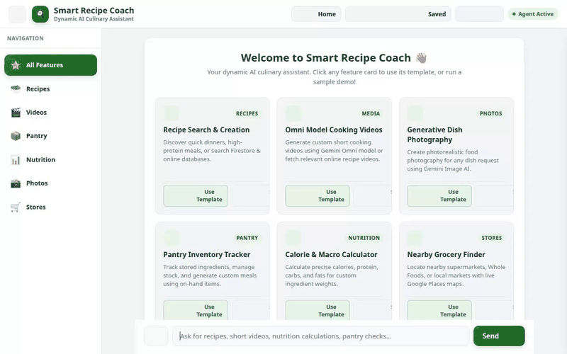

# Smart Recipe & Meal Coach 🍳

An intelligent, AI-powered culinary companion built with Google's Agent Development Kit (ADK), Gemini 2.5, A2UI cards, Vertex AI Memory Bank, Cloud Firestore, Cloud Storage, and Imagen 3.



---

## 🌟 Overview

**Smart Recipe & Meal Coach** helps users plan healthy meals, discover recipes, manage pantry inventory, evaluate nutritional values with a **Traffic Light health rating system**, generate food images and dish video demos, and locate nearby grocery stores.

The project features a **FastAPI backend and chat web interface** that proxies requests over the **A2A (Agent-to-Agent) protocol** while natively rendering **A2UI rich display cards** (cards, tables, and images).

---

## 🛠️ Implemented Google Cloud Services & Tools

This application is fully integrated with the following Google Cloud and external capabilities (grounded directly in `app/agent.py` and `app/tools.py`):

*   **Google Agent Development Kit (ADK) & Gemini 2.5**: Core agent reasoning loop, function calling, and structured prompt orchestration.
*   **Vertex AI Memory Bank**: Managed memory service (`VertexAiMemoryBankService` & `PreloadMemoryTool`) persisting user preferences, dietary restrictions, and cooking facts across sessions.
*   **Google Cloud Firestore**: Real-time NoSQL database holding recipe documents and pantry inventory items.
*   **Google Cloud Storage (GCS)**: Public media bucket hosting generated recipe images and video assets.
*   **Imagen 3 (Vertex AI Image Generation)**: Photorealistic AI food image generation (`imagen-3.0-generate-002`).
*   **Veo 2 & Video Tools**: Short dish video generation (`generate_recipe_video`) and public culinary video search fallback (`fetch_online_recipe_video`).
*   **Open Food Facts REST API & Traffic Light Nutrition Classifier**: Online nutrition lookup (`calculate_nutrition_and_macros`) categorizing foods along a Traffic Light health spectrum:
    *   🟢 **GREEN (Healthy Choice)**: High protein, nutrient-dense, balanced macros.
    *   🟡 **AMBER (Moderate Choice)**: Moderate nutrients, standard macro profile.
    *   🔴 **RED (Unhealthy Choice)**: High added sugars, saturated fats, or deep-fried calories (includes automatic caution messages).
*   **TheMealDB & Dynamic Online Recipe Synthesis**: Online recipe search tool (`fetch_public_recipes`) fallback when dish is not present in local database.
*   **Google Maps Geocoding & Places API**: Location services (`geocode_address`, `find_nearby_grocery_stores`) finding local grocery stores and specialty ingredients.
*   **A2UI v0.8 Protocol & Renderer**: Native card formatting for recipes, nutrition summaries, and inventory lists.

---

## 📁 Project Structure

```
smart-recipe-coach/
├── app/                        # ADK Agent logic & tools
│   ├── agent.py                # Root ADK agent configuration & A2UI system prompt
│   ├── tools.py                # Firestore, Imagen, Memory, Maps, & Nutrition tools
│   ├── a2ui_utils.py           # A2UI card renderer callbacks
│   └── prompt.py               # Custom system instructions
├── frontend/                   # Web Chat UI & A2A Proxy
│   ├── main.py                 # FastAPI server, A2A proxy runner, & local fallback
│   ├── static/                 # CSS/JS chat interface and A2UI renderer
│   └── requirements.txt        # Frontend proxy dependencies
├── demo.gif                    # Recorded application walkthrough animation
├── agents-cli-manifest.yaml    # Agents CLI deployment manifest
├── Dockerfile                  # Production container definition for Cloud Run
└── pyproject.toml              # Project dependencies & environment configuration
```

---

## 🚀 Local Setup & Running Instructions

Follow these steps to run the application locally on your machine:

### 1. Prerequisites

*   Python 3.11+
*   Google Cloud SDK (`gcloud` CLI) authenticated to your GCP project
*   Enabled GCP APIs: Vertex AI, Firestore, Cloud Storage, Maps Geocoding

### 2. Set Up Environment

Clone the repository and install dependencies:

```bash
# Set environment variables
export GOOGLE_CLOUD_PROJECT="<your-gcp-project-id>"
export GOOGLE_CLOUD_LOCATION="us-east1"
export GOOGLE_GENAI_USE_VERTEXAI="1"

# Install dependencies using uv
uv sync
```

### 3. Launch Local Server

To start the local FastAPI web server and chat interface:

```bash
cd frontend
python main.py
```

Once started, the server listens locally on port `8080`. Open your browser and navigate to port `8080` to interact with the Smart Recipe & Meal Coach chat UI.

---

## 🧪 Testing

To run unit, integration, and performance tests:

```bash
python scratch/sdet_e2e_load_test.py
```
